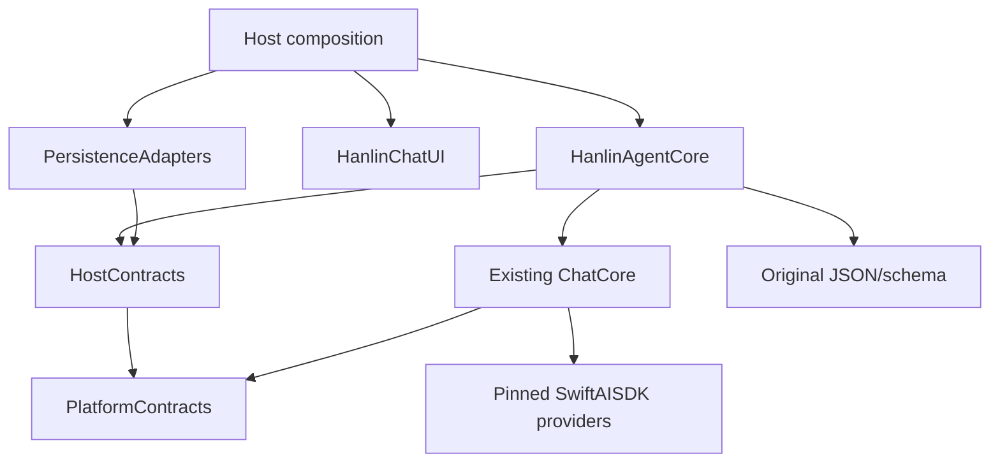

# SDK-01 current dependency and integration audit — 2026-11-19

Status: **AUDIT_DELIVERABLE_COMPLETE**. This is a source, contract and dependency design deliverable for Asana `1220542174541844`. Full SDK/host/UI/device acceptance remains tracked separately under parent `1219613181643838` and its implementation tasks.

## Scope and source identity

This audit reconciles the original 2026-11-15 design with the code that now exists. It preserves the original source audit and test records. The owner's current continuation authorization supersedes their historical pause/lease wording; those historical records are not new approval requirements.

| Input | Immutable source |
| --- | --- |
| Hanlin AI, four package manifests and app graph | `e0089cfb8c192530056aba39c7c8bbf945da75d3`, `davidpovarsky/hanlin-ai`, branch `codex/hanlin-product-completion-20261117` |
| Manifest/PBX evaluations | Executed at `e564dc29d24239309b113244bec4556c211c5b2d`; all evaluated input bytes were checked unchanged at the audited Hanlin source |
| SwiftAISDK, both core package graphs | `e7bf34111e603ca977becd007dd4e5bb109af857`, original `davidpovarsky/swift-ai-sdk` |
| Presentation Markdown | `6bde022876ef4af738c154b3d5c871984ef76195`, original `davidpovarsky/hanlin-streaming-markdown` |
| Yams | Exact `6.2.2`; resolved revision `a27b21e0c81c5bf42049b897a62aaf387e80f279` |
| Anytype consumer | `fe62128002926ced13cb682aba015d8dd615064a`, `davidpovarsky/anytype-swift`, branch `codex/chatgpt-wave15-sdk06-20261118` |
| Anytype's actual Hanlin input | `116cc6be0654a5d11bc56ba00e0310031107ee36` in `Tools/Hanlin/source.json`; SwiftAISDK matches `e7bf3411` |
| Otzaria consumer | `987bc0cecda8de70757e200e76346f5f0a18e8ba`, `davidpovarsky/Maktabah`, branch `codex/otzaria-complete-phases-20261117` |
| Otzaria's declared Hanlin input | Gitlink `080d1a2b264ead9e3f9df690f2dd0d3e81ebd07e`, `Vendor/HanlinSDK`; the submodule is not initialized in this inspected checkout |

A consumer pin is an observation, not an assertion that the consumer has the latest Hanlin changes. Updating a consumer requires its actual original integration tests and an exact source/dependency receipt. No SDK copy or alternate renderer was created for this audit.

## Products and dependency DAG

The three proposed Agent SDK libraries now exist in `Packages/HanlinAgentSDK`. The manifest also exports the synthetic `HanlinFixtureHost` executable. Its 13 targets include tests and original vendored JSON/schema targets; target count is not product count.

| Package | Public products | Main boundary |
| --- | --- | --- |
| HanlinAgentSDK | HanlinHostContracts, HanlinAgentCore, HanlinPersistenceAdapters, HanlinFixtureHost | Host contracts, the facade over the existing agent, metadata storage adapters, headless fixture |
| HanlinPlatform | 13 libraries, enumerated in the raw manifest/DAG evidence | Existing contracts, ChatCore and scripting platform |
| HanlinPresentationSDK | HanlinPresentationKit, HanlinRichUI, HanlinChatUI | Shared presentation state, rich surfaces and canonical chat/composer components |
| HanlinSkillFormat | HanlinSkillFormat | Original Yams-backed Skill frontmatter parsing and round-trip model |

`HanlinAgentCore` directly depends on HostContracts, existing HanlinChatCore, AISDKProvider, SwiftAISDK, original vendored JSON and HanlinExactJSONSchema. HostContracts depends on HanlinPlatformContracts. PersistenceAdapters depends on HostContracts. The original vendored Swift-JSON implementation is retained; its internal namespace/resource adaptation does not establish a new independent schema engine.

`HanlinChatCore` keeps its existing SwiftAISDK and four provider families. The complete target dependency list is machine-readable in [manifest-audit.json](evidence/sdk01-current-20261119/manifest-audit.json). Its package also owns other scripting targets; a manifest inspection does not prove a minimal download or build footprint for a consumer.

The presentation package deliberately has no AgentCore dependency. HanlinChatUI depends on PresentationKit, RichUI and the original Markdown product on iOS; RichUI depends on PresentationKit. The host composes the UI and the session. This maintains one source for reusable controls without making the UI a second agent authority.

The current Xcode graph has 11 native targets. The actual `AI_Hanlin` target declares and links HostContracts, AgentCore and PersistenceAdapters, as well as the three Presentation products. `AI_HLYTests` links AgentCore. `HanlinMiniApps` has **no Agent SDK product dependency** and retains its original platform/runtime products. This is verified PBX membership and link-phase source evidence, not a new Apple compilation.

## Source-to-package migration and ownership map

The historical map in [SDK_01_SOURCE_AUDIT.md](SDK_01_SOURCE_AUDIT.md) remains the initial proposal. The table below describes current disposition and the remaining adoption boundary. Paths are relative to the Hanlin repository unless a host is named.

| Original source / responsibility | Current canonical disposition | Remaining integration obligation |
| --- | --- | --- |
| `Packages/HanlinPlatform/Sources/HanlinChatCore/HanlinAISDKAgentEngine.swift` | Existing engine remains canonical. `HanlinAgentSession` receives one engine instance; it does not implement another stream/tool loop. | Each host must bind its actual lifecycle to that session and demonstrate cancellation/reopen behavior. |
| `HanlinAISDKModels.swift`, provider factory and stream events | Existing typed engine/provider envelopes are reused. | Preserve exact provider behavior and unsupported-capability errors during adoption. |
| Existing `HanlinChatEngine`, request builder and stream parser | Existing direct request/SSE path remains distinct from full agent orchestration. | A transport-only consumer does not establish Skills/tools/agent parity. |
| `HanlinChatModelConfiguration` | Transient resolved provider configuration; secret-free `HanlinModelReference` and injected credential port are in HostContracts. | Host owns Keychain and credential lifecycle; do not persist resolved configuration as transcript metadata. |
| `AI_HLY/Services/ChatServices/APIManager.swift` | Existing model/provider setup delegates through `HanlinAppAgentSessionOwner` and the original engine. | App orchestration, SwiftData and business services remain app-owned. |
| `AI_HLY/Downstream/ChatCore/HanlinAppAgentSessionOwner.swift` | Owns session, engine, generation and actual app conversation adapter. | Current native UI/lifecycle tests remain separate acceptance. |
| `HanlinAISDKToolAdapter`, `AssistantCapabilitySession`, `AssistantToolExposurePlanner` | Existing Skill/MCP/tool exposure remains behind the host capability and execution ports. | Reuse original authority and policy; moving a planner is unnecessary unless all call sites adopt the same implementation. |
| `HanlinSkillCatalog`, Skill store/import/read tools, `ToolResultStore` | Original app services; Yams parsing is reusable HanlinSkillFormat. | Real package imports, runtime readiness and large-result provenance must be verified in the consuming host. |
| `AgentRunLifecycleCoordinator` | Original app lifecycle remains app-owned. SDK facade carries explicit session/run identities. | No shared global cross-account session or duplicated engine. |
| `ChatMessages.swift`, app SwiftData models | App storage stays in Hanlin. `HanlinAppConversationStore` adapts SDK metadata. | Account/logout/erase/legacy migration acceptance must use original stores. |
| App transcript/evidence projections | HostContracts now carries typed transcript and structured-part identities; the app maintains its original projections. | History displays never restore live execution or interaction admission. |
| `AI_HLY/Downstream/ChatInput` and shared Composer | Canonical reusable composer/editor/chips are in HanlinChatUI; app wrappers supply app data and commands. | Native keyboard, IME, RTL and host parity remain real UI gates. |
| `ChatPresentation` and embedded-result hosts | Shared PresentationKit/RichUI/ChatUI plus original app result resolution. | A2UI routing, source identity, current host action and receiving-window acknowledgements remain host responsibilities. |
| Motion controls | Reusable disclosure/shimmer/preferences in HanlinChatUI. | Diagnostic control tests do not replace original interaction acceptance. |
| `HanlinCompactAgentContracts` | Existing compact client contract remains. | It is not a substitute for full in-process host integration. |
| `HanlinProductSplit` and companion bridge | Original separate-app transport/migration boundary. | In-process SDK consumers do not require the companion app; real cross-app transfer has its own tests. |
| Anytype Pinkha integration | Actual `PinkhaHanlinChatPresentation` composes HanlinAgentSession; `PinkhaHanlinChatView` mounts HanlinChatUI. Factory/launch/account/auth owners remain Anytype code. | Original scene, selection, write, consent and account lifecycle native tests; no Heart/CRDT replacement. |
| Otzaria integration | `MaktabahNativeRoutingComposition.makeHanlinHostSession` binds the original `OtzariaHanlinHostAdapter` and actual scene/profile/group/backend context. | Only contracts are linked. AgentSession and ChatUI composition is still absent from this audited consumer snapshot. |

The reusable UI package's presence is a source fact. It does not prove that every app surface has already adopted it or that all consumers are visually equivalent.

## Frozen integration seams

“Frozen” identifies the canonical contract a consumer must implement; it is not a pause or a request for further user approval.

1. **Session and context:** Host-issued `HanlinHostSession` contains conversation identity and `HanlinHostContext`. Namespace is the exact app/account/workspace/space tuple. Scene UUID and generation UUID are independent from opaque object/selection references and source revision. The host invalidates stale authority; references are not permissions.
2. **Host port:** `HanlinHostIntegration` exposes `apiVersion`, `context(for:)`, `catalog(for:)`, `execute(_:progress:)`, `cancel(_:)` and `open(_:)`. Progress uses the canonical `HanlinHostProgressHandler` alias. The current protocol declaration, not a reconstructed closure signature, is authoritative.
3. **Catalog and tool arguments:** Alias, logical identity, descriptor revision, original schema bytes and live context must remain associated. Original accepted JSON input is carried separately from the portable numeric projection. Never reconstruct original bytes from converted floating-point arguments.
4. **Effects:** The host retains `notDispatched`, `confirmedNoEffect`, `confirmedCommitted` or `uncertain` based on real evidence. A canceled task or transport failure does not establish rollback. Host-managed mutation does not promise atomic compare-and-swap or remote idempotency.
5. **Navigation:** `queued` and `presented` are distinct. The actual receiving scene/UI owner issues the final acknowledgement with exact request, context and target. SDK success cannot be inferred from a backend response alone.
6. **Persistence:** `HanlinConversationStore` uses namespaced load/save/delete and an explicit metadata revision. Metadata compare-and-replace is not a native document CAS guarantee. Host credentials, business storage and attachment grants remain outside the metadata record.
7. **Skills and tools:** `HanlinHostCapabilitySource.prepareStep` provides current aliases, Skill identifiers and instructions through the original host. Revoked or disabled Skills must be removed on the actual next step and blocked at load/read/execute boundaries.
8. **UI and rich results:** The host supplies immutable run/message/result identity, original interaction context and action resolution to the canonical renderer. Replayed surfaces are display data until a live host explicitly admits a current interaction.
9. **Diagnostics:** The default SDK diagnostic port accepts event kind and run identifier. Source auditing or fixture logs must not be presented as proof of real host effects.

These seams retain the original app authority and storage. Neither a second tool registry nor a second permission system is introduced by the audit.

## API and persistence version strategy

Three distinct version domains are maintained.

| Domain | Current source behavior | Evolution rule |
| --- | --- | --- |
| Source package | Exact Git commits; historical `0.1.0-preview.1` documentation is not a new stable release/tag | Pin the complete source/package graph. Record deliberate consumer updates and their actual regression results. |
| Host API | Major `1` required by catalog/session/dispatcher. Original baseline is `1.0`; `hostManagedMutation` requires minor at least `1`. Current Hanlin app advertises `1.1`. | Additive features require explicit capability/minor negotiation. Reject unknown major or unsupported guarantees before execution. Do not equate generic platform version ranges with this host contract's feature negotiation. |
| Conversation format | Current format `2`; readers accept `1...2`. v2 adds host-result identity and structured parts with namespace/conversation/run/step/order validation. | Read old records without silently rewriting them. New saves use the explicit current format. Unknown/newer or invalid records fail while preserving original data. |

Compatibility requires semantic checks as well as type compatibility. The caller supplies the original engine, host and store to `HanlinAgentSession`; the facade does not choose another provider or fall back to cloud after a host error.

The Apple on-device adapter is an actual provider over the existing engine. Its inspected source advertises **no tool support**, validates runtime FoundationModels availability, rejects unsupported tools/content/settings, preserves native role boundaries, and reports unknown usage without inventing counts. This is not full Apple agent/tool parity. Native availability transitions, eligible hardware generation and exact-once native tool behavior remain separate acceptance.

## iOS 26/27 and host target matrix

| Component / consumer | Checked-in deployment minimum | What this audit establishes |
| --- | --- | --- |
| HanlinAgentSDK | iOS 27.0 / macOS 26, tools 6.2, Swift 6 | Manifest evaluated successfully; no lowering of the real minimum |
| HanlinPlatform | iOS 27.0 / macOS 26, tools 6.2, Swift 6 | Existing core and platform graph preserved |
| HanlinPresentationSDK | iOS 27.0 / macOS 26, tools 6.2, Swift 6 | Three presentation products; Markdown is conditional on iOS |
| HanlinSkillFormat | iOS 26.0 / macOS 15, tools 6.2, Swift 6 | Parser package has its own lower supported minimum; this does not make the full agent graph iOS 26 compatible |
| Hanlin AI, MiniApps, extensions and tests | All 11 inspected native targets have iOS 27.0 in Debug/Release; Swift 6.0 | Target settings and actual link membership recorded in the PBX evidence |
| Anytype app and AnytypeTests | iOS 27.0 in all four inspected configurations each | Existing unrelated project/extension configurations still include 17.0; these are not the app's SDK deployment contract |
| Otzaria Maktabah-iOS | iOS 27.0 in Debug/Release | Original iOS app target observed; only HostContracts and PlatformContracts linked |
| Otzaria macOS targets / tests | macOS 15.0 / test entries 15.8 | Separate original target settings. No claim of a compatible full current macOS Agent SDK composition or a successful new build |

The owner's modern-platform correction permits iOS 26/27 integration and removes any requirement for iOS 17–25 compatibility. The current complete Hanlin graph actually requires 27.0. No legacy fallback, unrelated target raise or fictitious iOS 26 full-SDK support is proposed.

## Evidence and acceptance boundary

All accompanying evidence is source-bound. The evidence folder also records current source hashes, the four original dump-package outputs, dependency edges, consumer snapshots, and checks that the manifest/PBX evaluation inputs remain unchanged.

| Check | Result | Limit |
| --- | --- | --- |
| Four original Swift package manifest evaluations | **4 PASS**, Windows Swift 6.3.3 | Metadata evaluation only; no package resolution, compilation or Apple tests |
| Existing PBX parser and Agent SDK linkage validation | **PASS**, 11 native targets | Checked-in membership/build settings; not a compiled app |
| Yams source reuse check | **9/9 exact input byte matches** to `e44c57cf348b1037baa8416277a3414d7e93b805` / native run `43757913093` | Reuse of prior parser evidence, not a fresh test or app-adoption pass |
| Anytype / Otzaria source and integration matrix | **SOURCE_INSPECTED**, exact pins above | No new consumer native pass |
| New full SDK build, simulator, real model or physical device proof from this audit | **NOT_RUN** | Other task ledgers retain their own exact native results; they are not relabeled as this audit |

The four actual app Yams adoption methods remain scheduled with the real-Skill corpus work: `nestedMetadataSurvivesStoreSaveAndOverride`, `anchoredStoreEditDoesNotRewriteOriginal`, `zipNestedMetadataAndResourcesRemainLossless`, and `catalogMetadataFollowsSelectedSource`.

The SDK-01 deliverable is complete because it provides the pinned sources, module DAG, product/source migration design, canonical integration seams, version strategy and actual platform matrix required by the original audit task. SDK-02/03/04/05/06/07, the parent SDK epic, real Skills, live-provider, native UI, signed-product and physical-device acceptance retain their independent outstanding work. Closing this audit does not close those tasks.
