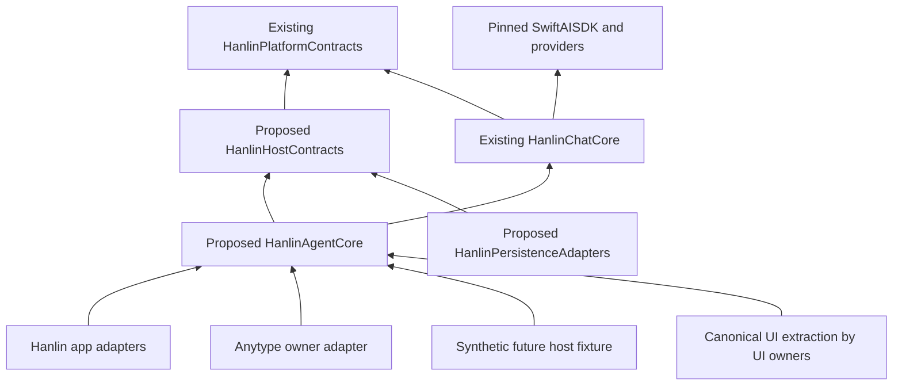

# SDK-01 source audit — 2026-11-15

> Historical 2026-11-15 source record. For current pins, implemented products, Host API 1.1, conversation format 2 and actual consumer/platform status, read [SDK-01 current audit (2026-11-19)](SDK_01_CURRENT_AUDIT_20261119.md). Historical pause/lease wording does not override the owner's current standing continuation authorization.

Status: SOURCE_AUDIT / implementation contracts proposed. No native acceptance claimed.

This document preserves the initial pinned audit. The later implementation lease and current preview delivery are recorded in `PUBLIC_API.md` and `IMPLEMENTATION_HANDOFF.md`; the historical docs-only lease below is not the later source grant.

- Parent: `1219613181643838`; audit: `1220542174541844`.
- Planned owned delivery: SDK-02 `1220542419128390`, SDK-03 `1220542199992529`, SDK-05 `1220542199999956`, SDK-07 `1220542174542004`.
- SDK-04 UI `1220542174541940`, SDK-06 Anytype `1220542414733348`, SDK-08 independent QA `1220542359756026` remain separate owners.
- MAIN_SESSION: `01a1dd57-5fd2-78d2-98f1-95b0eecbe97c`; controller verified Desktop origin, no parent/fork, actual gpt-6.1-sol/high.
- Repository: `davidpovarsky/hanlin-ai`; source SHA: `6a533ef4cc26c3c4e2ce90037bbe2e50f4862c36`.
- Worktree: `C:/Users/DAVID/Code/hanlin-agent-sdk-wave1-20261115`; branch: `codex/hanlin-agent-sdk-wave1-20261115`.
- Current exclusive write lease: NEW `docs/agent-sdk/**`. Existing source/manifests and all other worktrees are read-only.
- All parent and eight child descriptions were read, including the Apple on-device addendum and modern-platform correction. Historical FUTURE scheduling is superseded by current owner launch; acceptance gates remain.

## Existing implementation and dependency direction

`Packages/HanlinPlatform/Package.swift` already exports `HanlinChatCore` and `HanlinPlatformContracts`. Its pinned source specifies Swift tools 6.2, Swift language mode 6, **iOS 27.0 and macOS 26**. The older task description saying iOS 26 is not this baseline's manifest. Preserve 27; iOS 26 support would require a separately approved dependency/availability decision, not silently lowering the manifest. The app project contains iOS 27.0 and Swift 6.0 settings. Compiler and installed Apple SDK versions have not been queried or executed in this tranche.

The model SDK is pinned to `davidpovarsky/swift-ai-sdk` revision `43ebcfaae67ca2c47ea1ce940d66b581e60ca7f6`. HanlinChatCore depends on the existing contracts plus SwiftAISDK, AISDKProvider, AISDKProviderUtils, OpenAIProvider, AnthropicProvider, GoogleProvider and OpenAICompatibleProvider. Other package products include scripting/runtime/UI components; they must not become required SDK imports. Local SwiftPM package resolution may still resolve the parent package graph: this audit has not measured downloads or proved a small standalone build.

Recommended packaging for the next lease is NEW `Packages/HanlinAgentSDK/` with its own manifest and local dependency on `../HanlinPlatform`. This preserves the existing package manifest and gives the new writer exclusive files. It supersedes the initial audit suggestion to add new targets directly to HanlinPlatform; no manifest has been edited. Proposed products: HanlinHostContracts, HanlinAgentCore and HanlinPersistenceAdapters. A HanlinChatUI product is reserved for the canonical UI owners after extraction design; it is not a new renderer or placeholder view. See `HOST_CONTRACT_PROPOSAL.md` for the contract boundary.

## Source-to-package migration map

All paths below are relative to the repository. A destination is a proposal, not an implemented or compiled product. File hashes for the inspected source snapshot are recorded in `source-inventory.json`.

| Canonical source | Existing behavior / coupling | Proposed treatment and integration gate |
| --- | --- | --- |
| `Packages/HanlinPlatform/Sources/HanlinChatCore/HanlinAISDKAgentEngine.swift` | Actor wrapping SwiftAISDK streamText, tool execution, per-step preparation, dynamic tool reload, cancellation, explicit optional step budget | Keep this one agent loop. SDK facade delegates here; no copied loop. Provider integration needs an exact shared-core lease. |
| `HanlinAISDKModels.swift` in the same directory | Cloud provider kinds; typed message/tool/event envelopes; MainActor Sendable executor | Reuse definitions and events. Correlation/persistence envelope belongs above core; do not break live event consumers. |
| `HanlinAISDKProviderFactory.swift` and `HanlinNonEmptyLanguageModel.swift` | Four provider families, injected fetch, transport hooks, bounded empty-response handling | Preserve cloud behavior. Apple should be one thin provider adapter in this pipeline; no router or automatic fallback. |
| `HanlinChatEngine.swift`, `HanlinChatRequestBuilder.swift`, `HanlinChatStreamParser.swift` | Existing direct request/SSE path and platform network transport | Existing capability, not full agent/Skills/MCP parity. Do not create a third transport. Audit both call paths during Apple/app integration. |
| `HanlinChatModelConfiguration.swift` | Immutable configuration is Codable and contains `apiKey`; endpoint/provider/settings supplied by caller | Treat resolved configuration as transient. Never use it as persisted conversation/model selection metadata. Add secret-free reference plus host credential resolution above it. |
| `HanlinChatMessage.swift`, `HanlinChatStreamEvent.swift`, captured replay and transport trace files | Lightweight chat message/event types and raw transport observation | Reuse when appropriate; full tool transcript requires versioned correlation. Raw observers are sensitive opt-in host hooks, not safe default logs. |
| `AI_HLY/Services/ChatServices/APIManager.swift` (SDK entry around line 3686) | Creates existing engine and tool adapter; owns SwiftData ModelContext, app services, callbacks, diagnostics and shared lifecycle | Extract responsibilities through injected host ports in stages. Do not copy the  app orchestration class or declare it portable. Hanlin app adoption requires a separate exact seam. |
| `AI_HLY/Downstream/AgentSkills/HanlinAISDKToolAdapter.swift` | NativeToolExecutionContext, SwiftData, AssistantToolBridge authority, shared MCPRuntimeProvider, catalog, attachments, result store, diagnostics | SDK adapter must consume injected catalog/execute/progress ports and canonical envelopes. Actual native business execution stays in host adapter. Existing authority is preserved. |
| `AssistantCapabilitySession.swift` in the same directory | Per-run exposures and loaded skills, but default ToolResults storage uses Hanlin/chat-only path | Inject namespaced storage; no unqualified chat-only persistence in a multi-account/Space host. Preserve visibility reset vs retained-history semantics. |
| `AssistantToolExposurePlanner.swift` in the same directory | Pure deterministic schema-budget planner; unlimited by default, oversized-first-tool policy | Candidate for deliberate source promotion under an exact move/adoption lease, not a copy. No new planner in this docs tranche. Model capability limits remain explicit. |
| `HanlinSkillCatalog.swift`, `ToolResultStore.swift` in the same directory | Production catalog singleton/resources and app file storage | Inject Skill/MCP sources and a result repository. Preserve loaded-skill provenance and large-result references; no host business storage inside SDK. |
| `AI_HLY/Downstream/AgentActivity/AgentRunLifecycleCoordinator.swift` | Shared singleton with active run/task/recorder and stale-run protections | Preserve generation/cancel behavior; reusable session must have per-host/per-conversation lifecycle. Do not turn the app singleton into a cross-host service or copy a second agent engine. |
| `AI_HLY/Model/ChatMessages.swift`, `AI_HLY/ChatView.swift` | App SwiftData models, ModelContext, @Query, drafts/history and run orchestration | Host-specific SwiftData adapter remains in Hanlin. Core must import without these app types. No live schema migration or source-file moves yet. |
| `AI_HLY/Downstream/AgentActivity/{Transcript,Evidence}/**` | App transcript, tool results, evidence and provenance | UI owners must define a common projection preserving identifiers and ordering; source presence is not reusable UI acceptance. |
| `AI_HLY/Downstream/ChatPresentation/{ChatEmbeddedResultHost,ChatPresentationBridge,ChatExecutionTimelineItemView,ChatUserMessageSurface}.swift` | Host presentation includes concrete built-in registration lookup and native result types | Preserve existing rendering; inject host resolution instead of copying views. Eitan owns live A2UI renderer/binding. |
| `AI_HLY/Views/Components/{ChatViewComponents,ChatViewBottom}.swift`, `AI_HLY/Downstream/ChatInput/**` | Canonical bubbles, Composer, draft/send/model/keyboard and shared compact workspace | Maya/UI lease; read-only. No replacement ChatView or demo UI. Source identity, native interaction and physical parity remain acceptance gates. |
| `Packages/HanlinPlatform/Sources/HanlinScriptExtensions/HanlinCompactAgentContracts.swift` | Compact client boundary | Not evidence of full host tools/Skills/MCP/UI parity. Never use a transport-only wrapper as completed SDK. |
| `Packages/HanlinProductSplit/**`, companion and app project graph | Separate foreground companion bridge and migration responsibility | Tomer/Split owns integration. In-process SDK never requires companion deep links or Hanlin installation. |

## Existing authority contracts to reuse

The canonical `HanlinPlatformContracts` product already has logical provider/tool identities, descriptor and catalog revisions, JSON Schema documents, tool routing, invocation limits, idempotency keys, grant IDs, execution origins, progress events and typed outcomes. Permission requests/decisions/grants/revocation/effective-policy types and presentation hints also already exist.

Important distinction: `HanlinJSONSchemaDocument` validates the document envelope/canonical representation; this does not by itself prove arguments satisfy every JSON Schema keyword. The current core `makeTools` validator converts JSONValue, rather than performing complete input-schema validation. Host validation at execution remains mandatory. Also, core `makeTools` constructs a dictionary using unique keys: duplicate definitions must be rejected by a throwing adapter before that operation, rather than allowed to crash. These are source findings, not executed regression tests.

No new permission regime, always-allow service, business action registry or MiniAppHost ABI is proposed. The SDK's job is to carry scoped requests to the host's current authority and normalize results. A model-visible alias is never a grant.

## Platform and host matrix

| Consumer | Pinned / permitted observation | Current evidence and owner dependency |
| --- | --- | --- |
| Existing HanlinPlatform / core | iOS 27.0, macOS 26; tools 6.2 / Swift mode 6 | Manifest inspected at pinned SHA. No compilation run. Preserve current minimum. |
| Hanlin AI app | Project settings include iOS 27.0 / Swift 6.0 | App source is not independently portable. Frozen UI/app adoption needs owned seams. |
| Anytype/Pinkha | Owner permits relevant app/product target raise to iOS 26/27; old iOS 17 is not a constraint | SDK-06 frozen audit consumed at `389f12320d89975ebb58d2aaf13b051693194d59`; two artifact hashes verified, 57-blob map read selectively. No direct host worktree inspection or runtime validation here. No native revision/CAS or cancellation rollback guarantee; proposed typed effects/unsupported conditional writes incorporated in HOST_CONTRACT_PROPOSAL. |
| Otzaria | Owner permits scoped raise to iOS 26/27; old iOS 18.6 is not a constraint | Synthetic host boundary only. No API enumeration, Source/Otzaria/Actions reads or production adapters performed. Versioned unified port is a dependency. |
| Apple local model | FoundationModels runtime availability required regardless of minimum target | Official docs researched, no installed SDK compile or eligible-device observation. No API key/PCC/AppGroup needed for this feature. |

## Integration locks and validation plan

Current write scope is docs only. Core/provider files, PlatformContracts, runtime/metadata/Host ABI, MCP observers, Composer, A2UI, app orchestration, manifests/locks, project files, workflows, entitlements and other repositories remain untouched. Source migration means one final canonical implementation with consumers switched deliberately; no temporary second engine or renderer.

The repository has the existing manually dispatched `build-ios26-unsigned-ipa.yml` and focused validation selectors. Its name is not proof of the actual SDK version or deployment target. Relevant native verification must use faithful source/dependency closure and exact pins under the existing serialized resource policy. No workflow was dispatched; no dependencies or build caches were created here.

Next meaningful tests after an implementation lease: unknown/duplicate tools, schema mismatch, scoped read and permitted mutation, denied/confirm/revoke, stale Space/scene/revision before mutation, duplicate idempotent calls, cancellation, superseded run, progress ordering, store namespace/logout isolation, malformed replay, byte budgets and rollback on synthetic stores. Existing core provider/cancel/long-step tests remain regression candidates, not passes from this audit. UI/Anytype/Otzaria real actions and eligible physical-iPad Apple tests require their owners and actual target builds.

Evidence levels: SOURCE inspected; DOCUMENTATION researched; BUILD, SIMULATOR, DEVICE, USER ACCEPTANCE all NOT_RUN. SDK-01 may be reviewed as an audit milestone; parent/full child acceptance is not complete.
