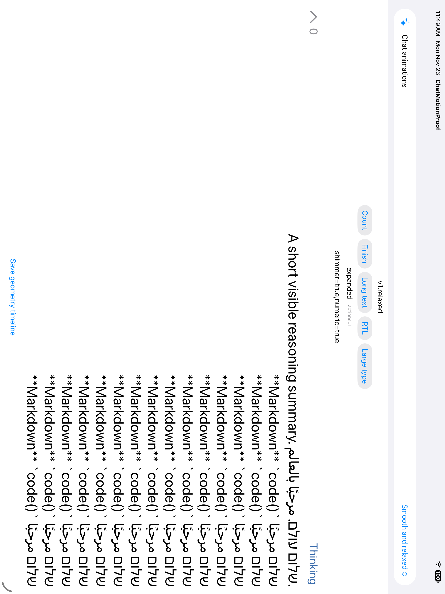

# Original Motion C: native pass and complete landscape capture

Run [45166004801](https://github.com/davidpovarsky/hanlin-ai/actions/runs/45166004801), attempt 1, executed the original C method on **3a9e1681f03080412d0ee934a00b307f3d7ae59c**. Its only selector was `ChatMotionProofUITests/MotionUITests/testCReadableLongContentRTLTypeOrientationAndCompletion`; A, B and D were not selected. The method **passed in 40.222079 seconds**, with no failed assertions. The native job and the workflow both succeeded.

The run used Xcode 27.2 (27B52), Swift 6.4.2 and an arm64 iPad Pro 13-inch (M5) simulator on iOS 27.2 (24B8117). The fresh owned simulator reached native bootstatus readiness on its first attempt in 159.56 seconds, without recovery. This is actual boot and XCTest evidence, beyond the earlier read-only capacity probe. The original runtime warning, “Update the Info.plist: Support for all orientations will soon be required,” is retained in `tests.json`; it was not a failed assertion.

## Exact original visual evidence

All four native PNG attachments were extracted unchanged from the archived xcresult. Every PNG chunk CRC passed. Their attachment names, timestamps and payload references were read from the original serialized xcresult metadata, rather than inferred from appearance. The payload mapping and complete SHA256 values are in `visual/extraction-receipt.json`; `native-attachment-metadata.txt` retains the source metadata. Neither pixels nor orientation metadata were edited.

| Native attachment | Original file | Observation |
| --- | --- | --- |
| Expanded large text, RTL, portrait | `0aaf7b3e4ccbd30a0c3c.png` | Readable Hebrew/Arabic/English text and original expanded Thinking header. |
| Existing app-boundary landscape screenshot | `e68df47479ebc94aa4a4.png` | Still shows a black band and a truncated right edge. This original attachment remains preserved. |
| Additional full-screen landscape screenshot | `15ad9d20764dbdce3f81.png` | Complete horizontal viewport, full Thinking label and RTL large text, complete preset row and bottom control; no black band or right-edge truncation. |
| Completed and collapsed portrait | `fd015d1a43b6e691931a.png` | Readable original content after details; `collapsed`, `actions=2`, and `shimmer=false;numeric=true`. |

The original full-screen image was captured at 11:49:55.857 UTC, 0.270 seconds after the original app-boundary screenshot at the same C checkpoint. Both files carry EXIF orientation 8, but the full-screen payload is 2064×2752 pixels and displays as 2752×2064; the app-boundary payload is 2752×2064 and displays as 2064×2752. The new evidence resolves the specific capture gap without changing the original UI, animation, gestures, waits, completion check or final collapse assertion. The presentation owner reviewed all four original images; root independently reviewed the original full-screen image and reached the same bounded observation.

This is **C fixture acceptance**. Long content naturally extends beyond the visible scroll viewport. The fixture contains literal Markdown markers rendered as text, so these images do not prove the production Markdown renderer, the full Hanlin chat, agent engine or scroll integration. There is no iPadOS 26 or physical-device claim.

## Source and input qualification

The native pipeline selected the actual `HanlinChatUI` product from the canonical SDK checkout. `proof-inputs.json` binds all 364 selected source/resource files, all ten fixture inputs and the generated selected manifest to the run source. `sdk-resolved-inputs.json` binds the eight actual resolved dependency trees and six packaged resource-bundle instances. The known Equatable macro input was admitted before compilation at the exact original revision `597c2bb34af0c51331eb3b5e705f942d8ee20daa` (1.4.1); automatic package resolution remained disabled during build and test.

Artifact 14816840026 is 68,440,465 bytes. Its API size/digest and ZIP CRC were verified. Its SHA256 is `16c454d58a723f5422f4709aafb7ae8078cb3536cc4a1c9af4fc36ec5f226c39`. The readable archived xcresult has SHA256 `84afe21594556745db392d1d8f510486329ba0985e8e88f7d8ac836480b75baf`. The original artifact contains the raw result, video and source archive; this repository receipt retains the bounded native output, full input inventories and original PNGs instead of duplicating the large archives.

Preflight took 404 seconds, dependency resolution 382, build 159, the XCTest phase 181 and result export 12. These are distinct from the C method’s 40.222079-second duration. The single finite watcher `job_b551ad8dee69` ended normally at 11:52:39 UTC. No other Motion run or root native job was cancelled or replaced.

## Remaining acceptance

The earlier B failure is unchanged. A was not selected. The two earlier D attempts executed no tests because of simulator/runner admission failures; C does not supply their missing diagnostic result. Full-app and host acceptance remain separate. This receipt does not close the overall Motion or Presentation tasks.
