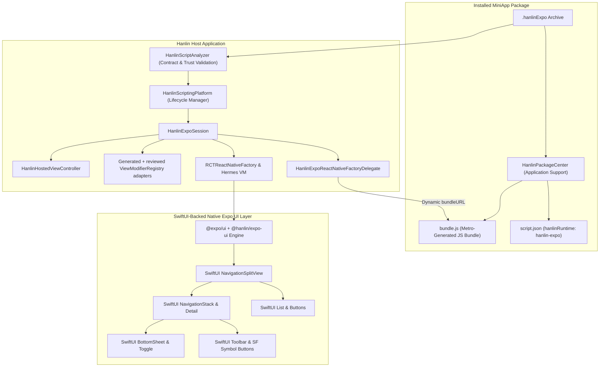

# Hanlin Expo / React Native SwiftUI Dynamic Runtime Guide

This document specifies the architecture, operational contracts, performance metrics, and development guidelines for the **Hanlin Expo / React Native SwiftUI Runtime** (`hanlinExpo`), enabling dynamically installed MiniApps (`.hanlinExpo`) to render Apple SwiftUI components using Expo UI (`@expo/ui/swift-ui`) and Hermes on iOS 27+.

Current source/version and extension-execution boundaries are tracked in the
[existing SDK authority audit](miniapp-sdk/README.md). A rendered component or
foreground Host API does not establish Share/Intent/Translation/Notification
reachability; consult that matrix before advertising a surface as supported.

---

## 1. Architectural Overview & Mental Model

Hanlin AI features a multi-engine runtime platform capable of hosting isolated MiniApps across multiple paradigms:
* **`scriptingJSC`**: Existing JavaScriptCore/`HanlinScriptUI` legacy paths remain available; dedicated development is frozen. The original ScriptWidget renderer/services are an active, separately identified widget engine.
* **`hanlinNativeScript`**: Original NativeScript runtime with the installed native metadata and Core UI.
* **`hanlinExpo`**: Original Expo/React Native runtime executing on Hermes, with native declarative UI components backed by Apple's SwiftUI through Expo UI. `get_miniapp_sdk` returns the exact versions selected for the installed host.

<!-- miniapp-snippet: expo.architecture -->


### Key Architectural Invariants:
1. **No Host Recompilation for Installed Bridge Capabilities**: The host app (`AI_Hanlin`) does not compile MiniApp JavaScript into its binary. The JS bundle is resolved dynamically from the installed package directory. Adding a new native SwiftUI bridge capability or regenerating for a new Apple SDK requires one host build; MiniApps using the capability surface already installed in that host do not.
2. **Dynamic Package / Session Switching**: Swapping from MiniApp A to MiniApp B instantiates an isolated `HanlinExpoSession` pointing to the selected package's bundle path; the host application remains alive without recompilation.
3. **SwiftUI-Backed Components via Expo UI**: The `@expo/ui/swift-ui` components tested in the probe (including `NavigationSplitView`, `NavigationStack`, `List`, `Toolbar`, `Button`, `Toggle`, and `BottomSheet`) are backed by genuine Apple SwiftUI view structs and modifiers. React Native, Hermes, and Expo UI provide the underlying runtime host, event bridging, and state management.
4. **Session Teardown Lifecycle**: Dismissing an active Expo MiniApp triggers explicit teardown in `HanlinExpoSession.shutdown()`, removing the hosted view, clearing `reactHost` references, releasing factory/delegate resources, destroying the Expo app context, and unregistering custom modifiers.

### Generated SwiftUI capability pipeline

The production bridge follows one reproducible path:

<!-- miniapp-snippet: expo.inventory-flow -->
```text
stable Xcode 27 iPhoneOS SwiftUI + SwiftUICore interfaces
  -> SwiftSyntax inventory and per-signature classification
  -> generated native SwiftUI wrappers + typed TypeScript
  -> @hanlin/expo-ui 1.0.0 (bridge capability contract 3.0.0)
  -> dynamic TSX MiniApp
  -> real SwiftUI views in the prebuilt Hanlin host
```

The complete device interfaces are local generation inputs and are not committed. The checked-in
inventory identifies `xcode-27.0-ios-27.0-arm64e-apple-ios`, and coverage records the input hashes,
generated versus reviewed/manual adapters, and every unsupported, superseded, deprecated, private,
SPI, or host-lifecycle-only signature. Generation is deterministic and has a check mode; see
`Tools/SwiftUIBridge/README.md` for the exact commands and unresolved-signature policy.

`@expo/ui` remains the native Expo SwiftUI foundation. `@hanlin/expo-ui` re-exports the supported
surface, adds the generated module and reviewed semantic adapters, and routes capability-gated
runtime/file operations to `HanlinHostServices`. The native module resolves the provider from the
concrete Expo `AppContext`, so JavaScript never supplies a session identifier. Packages may omit
`hanlinExpo.bridgeVersion`; when present, versions through `3.0.0` are accepted and newer contracts
are rejected before launch.

---

## 2. Dynamic Bundle Loading & Host Integration

### 2.1 The Dynamic Factory Delegate

In standard Expo/React Native brownfield setups, `bundleURL()` typically points to a resource bundled inside `Bundle.main`. In Hanlin, `HanlinExpoReactNativeFactoryDelegate` dynamically provides the installed package bundle URL:

<!-- miniapp-snippet: expo.host-delegate -->
```swift
final class HanlinExpoReactNativeFactoryDelegate: ExpoReactNativeFactoryDelegate {
    private let appBundleURL: URL

    init(bundleURL: URL, appContext: AppContext) {
        self.appBundleURL = bundleURL
        super.init(appContext: appContext)
    }

    override func sourceURL(for bridge: RCTBridge) -> URL? {
        return appBundleURL
    }

    override func bundleURL() -> URL? {
        return appBundleURL
    }
}
```

### 2.2 Session Lifecycle (`HanlinExpoSession`)

`HanlinExpoSession` manages the isolated runtime instance:
* **Initialization**: Registers custom SwiftUI modifiers with `ViewModifierRegistry`, sets up `RCTReactNativeFactory`, and creates the root view via `rootViewFactory.view(withModuleName:initialProperties:launchOptions:)`.
* **Container Hosting**: Embeds the root view into a `UIViewController` container ready for `HanlinHostedViewController` presentation.
* **Teardown (`shutdown`)**:
  - Removes the hosted root view from its superview (`hostedView?.removeFromSuperview()`).
  - Clears `reactHost` on `rootViewFactory` (`rootViewFactory.reactHost = nil` and `rootViewFactory.setValue(nil, forKey: "_reactHost")`).
  - Releases factory and delegate references (`reactNativeFactory = nil`, `factoryDelegate = nil`).
  - Destroys the Expo `AppContext` (`appContext?.destroy()`).
  - Unregisters custom modifiers (`HanlinExpoModifierRegistry.unregisterCustomModifiers()`).
  - Clears the active session singleton reference.

---

## 3. Extensible SwiftUI Modifiers (`HanlinExpoModifierRegistry`)

Expo UI supports registering custom Swift modifier factories using its public `ViewModifierRegistry`. Hanlin implements the `navigationBarTitleDisplayMode` modifier:

### Swift Implementation:
<!-- miniapp-snippet: expo.host-modifier -->
```swift
import ExpoUI
import SwiftUI

public enum HanlinExpoModifierRegistry {
    public static func registerCustomModifiers() {
        ViewModifierRegistry.register("navigationBarTitleDisplayMode") { (params: [String: Any]) in
            let modeString = params["displayMode"] as? String ?? "inline"
            let displayMode: NavigationBarItem.TitleDisplayMode = switch modeString {
            case "large": .large
            case "automatic": .automatic
            default: .inline
            }
            return AnyViewModifier { content in
                content.navigationBarTitleDisplayMode(displayMode)
            }
        }
    }

    public static func unregisterCustomModifiers() {
        ViewModifierRegistry.unregister("navigationBarTitleDisplayMode")
    }
}
```

### TypeScript Usage (complete `App.tsx`):
<!-- miniapp-snippet: expo.app -->
```tsx
import { Host, NavigationSplitView, Text } from '@expo/ui/swift-ui';
import { createModifier } from '@expo/ui/swift-ui/modifiers';

export const navigationBarTitleDisplayMode = (mode: 'inline' | 'large' | 'automatic' = 'inline') =>
  createModifier('navigationBarTitleDisplayMode', { displayMode: mode });

export default function App() {
  return (
    <Host style={{flex: 1}}>
      <NavigationSplitView modifiers={[navigationBarTitleDisplayMode('inline')]}>
        <NavigationSplitView.Sidebar><Text>Library</Text></NavigationSplitView.Sidebar>
        <NavigationSplitView.Detail><Text>Select an item</Text></NavigationSplitView.Detail>
      </NavigationSplitView>
    </Host>
  );
}
```

---

## 4. Package Contract & Specification (`.hanlinExpo`)

A `.hanlinExpo` package is a standard ZIP archive containing:
* `script.json`: Root package manifest.
* `package.json`: Component metadata and dependency specifications.
* `bundle.js`: Runtime bundle generated by the original Metro, Expo Babel preset and installed host configuration through `build_miniapp`.
* `assets/`: Original packaged static media (icons, texts, audio).
* `source/` and `hanlin.authoring.json`: Retained authoring input and source/output identity used by validation and repair.

### Example `script.json`:
<!-- miniapp-snippet: expo.script -->
```json
{
  "name": "Expo SwiftUI Probe A",
  "version": "1.0.0",
  "description": "Dynamic Expo / React Native SwiftUI MiniApp for Hanlin",
  "entry": "bundle.js",
  "runInApp": true,
  "hanlinRuntime": "hanlin-expo"
}
```

### Package versions and prepared contracts

Read `get_miniapp_sdk(engine: "expo")` before writing dependency versions. Its
`selectedEngine.packageVersions` lists the installed original npm versions,
including Expo, React, React Native, Expo UI and Widgets. Use those values for
the packages imported by the source. Expo's supported dependency graph is the
source of version compatibility; unrelated newest package versions are not a
coherent SDK.

`build_miniapp` writes the prepared package's `hanlinExpo` contract from the
SDK's `hostContract`. Runtime, Expo SDK, bridge contract and Native API ABI
identities are different fields. Authors should not copy an old numeric
`hanlinExpo` example or equate the bridge's npm version with its native contract.
The [authoring guide](miniapp-sdk/AUTHORING_WORKFLOW.md) describes a complete
source project and the same compiler/build/import sequence used by the agent.

---

## 5. Technical Metrics & Section 27 Overhead

### 5.1 Historical binary size observation

The following table is an older measured snapshot, not the size of a newly resolved build. Current native archives are produced or obtained from the exact original package inputs; consult that build's artifact receipt for current sizes and identities:

| XCFramework | Fat Universal Archive | Device Slice (`ios-arm64`) |
|:---|:---:|:---:|
| `ExpoUI.xcframework` | 104.60 MB | 34.70 MB |
| `ExpoModulesCore.xcframework` | 75.20 MB | 24.97 MB |
| `hermesvm.xcframework` | 66.83 MB | 6.04 MB |
| `React.xcframework` | 112.54 MB | 12.26 MB |
| `ReactNativeDependencies.xcframework` | 44.75 MB | 1.19 MB |
| `ExpoBrownfield.xcframework` | 2.68 MB | 0.89 MB |
| `ExpoModulesWorklets.xcframework` | 2.76 MB | 0.92 MB |
| **Total Overhead (Uncompressed)** | **409.36 MB** | **80.97 MB** |

> [!NOTE]
> Fat universal archives contain multi-platform and simulator slices (`ios-arm64_x86_64-simulator`, `maccatalyst`, `tvos`, `xros`). When archiving for device, Xcode bundles only the target architecture slice (`ios-arm64`, totalling 80.97 MB uncompressed). Actual compressed App Store / TestFlight download and install sizes are reported by App Store Connect after processing the build archive.

### 5.2 Runtime Performance & Validation Status

Physical-device memory, FPS, and startup-latency benchmarks have not yet been collected.

Prior spike closure verification (run `35473839956` on the isolated spike branch) verified isolated functionality with Xcode 26. The current iOS 27 bridge uses the repository's existing manual `.github/workflows/validate-expo-runtime-spike.yml` workflow, selecting stable Xcode 27 and an iOS 27 iPad Simulator. Its focused scope compiles the host and Expo bridge, then exercises package resolution, dynamic bundle loading, SwiftUI composition, dynamic package switching, lifecycle, and uninstall behavior without broad repository validation.

---

## 6. Detailed Comparison: Expo SwiftUI vs. NativeScript Core

| Dimension | Hanlin Expo Runtime (`hanlinExpo`) | Hanlin NativeScript (`hanlinNativeScript`) |
|:---|:---|:---|
| **JS Virtual Machine** | **Hermes VM** (Meta, optimized for low memory & fast startup) | **JavaScriptCore** / V8 (WebKit native bridge) |
| **Bridge Mechanism** | **JSI (JavaScript Interface)** & C++ TurboModules | **Direct Objective-C Runtime Metadata Reflection** |
| **UI Paradigm** | **SwiftUI-backed components** via `@expo/ui/swift-ui` in React Native host | **NativeScript Core UI** (`Page`, `Frame`) + Pre-embedded SwiftUI Providers |
| **Layout Engine** | Native SwiftUI Layout (containers: `NavigationSplitView`, `VStack`, `HStack`) | Flexbox Layout (Yoga / NativeScript layout engine) |
| **Modifier Architecture** | Dynamic registry (`ViewModifierRegistry`) | Pre-compiled Swift Fixture Providers (`UIDataDriver`) |
| **MiniApp Package Size** | **~266.7 KB** (current generated probe fixture size; full Metro JS bundle) | 12 KB – 45 KB (depends on core modules bundled) |
| **Threading Model** | Multi-threaded (JS thread + Shadow thread + Main UI) | Single-threaded Main Loop (JS runs directly on main/worker) |
| **Package Switching** | Dynamic package/session switching (isolated session per package bundle path) | Context recreation / isolate reload |
| **Platform Fidelity** | **SwiftUI-backed native views** for supported components (`NavigationSplitView`, `Toolbar`, `BottomSheet`, `Toggle`) via Expo UI | Direct UIKit views + wrapper-hosted SwiftUI |

> [!NOTE]
> In baseline testing, NativeScript verification was confirmed specifically by passing `HanlinNativeScriptProductionE2ETests/testProductionSwiftUIInteractionCoreRegressionAndLifecycle`.

---

## 7. Developer Guide: Creating an Expo SwiftUI MiniApp

### 7.1 Directory Layout
<!-- miniapp-snippet: expo.layout -->
```
MyMiniApp/
├── script.json         # Hanlin manifest
├── package.json        # Dependencies declaration
├── tsconfig.json       # Portable source typechecking configuration
├── hanlin.authoring.json # Source entry and retained-source contract
├── App.tsx             # Root SwiftUI component tree
└── index.ts            # Entrypoint registering App with AppRegistry
```

### 7.2 Entrypoint Registration (`index.ts`)
<!-- miniapp-snippet: expo.registration -->
```typescript
import { AppRegistry } from 'react-native';
import App from './App';

AppRegistry.registerComponent('main', () => App);
```

The foreground host calls `HanlinExpoSession.start()` with the root module name
`main`. Register that exact name in the authoring entry selected by
`hanlin.authoring.json`. This React root name is independent of the npm package's
`name` and of `package.json.main`, which identifies the prepared JavaScript file.
The package builder preserves the registration written in source; it does not
rename an `AppRegistry` key or read a package field to override the host root name.

### 7.3 Building & Packaging
Validate and build the source project with `validate_miniapp` and `build_miniapp`
using `engine: "expo"` and the project's path. The same operations are available
through the [shared authoring CLI](miniapp-sdk/AUTHORING_WORKFLOW.md#desktop-and-ci).
Use the successful build report's `archivePath` for import through **Add Apps** or
`import_miniapp`, then inspect the actual receiver receipt.

The repository command `node Scripts/Expo/build-probe.mjs` builds the tracked
Expo probe fixtures for validation. TypeScript and Metro success establish
compilation and packaging; native launch and rendering require their own runtime
check, including the root registration above.


---

## 8. Embedded Native API Hybrid Extension (`ios-native-api`)

Starting in contract version `1.0.0`, Hanlin Expo MiniApps can optionally declare the `ios-native-api` capability to access NativeScript's Native API JSI, TurboModules, and Fabric components without replacing or affecting the Hermes JavaScript runtime.

### 8.1 Capability & Dependency Contract
- **Manifest Declaration**: MiniApps requiring native API access must specify `"ios-native-api"` in `script.json.capabilities`.
- **TypeScript Facade**: `@hanlin/expo-native-api` re-exports the original `@nativescript/react-native` installed in the SDK. Read both exact npm versions from `selectedEngine.packageVersions`.
- **Worklets Engine**: use the exact `react-native-worklets` version in `selectedEngine.packageVersions` and the host contract. Its original `runOnUI` API schedules UI-thread work; a historical version in an example is not the installed contract.
- **UI Composition**: Native UIKit views defined with `defineUIKitView` or view controllers with `defineUIViewController` can be embedded into the native SwiftUI view tree using `<RNHostView matchContents={true}>` from `@hanlin/expo-ui`.

### 8.2 Security & Isolation Boundary
1. **Static Analysis**: `HanlinScriptAnalyzer` enforces pinned dependencies and rejects MiniApps importing `@nativescript/react-native` without declared `ios-native-api` grant.
2. **Native Gate**: `HanlinExpoNativeAPIGate` validates session authorization at native C++ entry points (`install`, `installWorkletRuntime`, `NativeScriptCreateUIKitHost`).
3. **Dynamic Revocation**: Revoking `ios-native-api` immediately terminates the active `HanlinExpoSession` and cleans up Hermes and Fabric resources.
