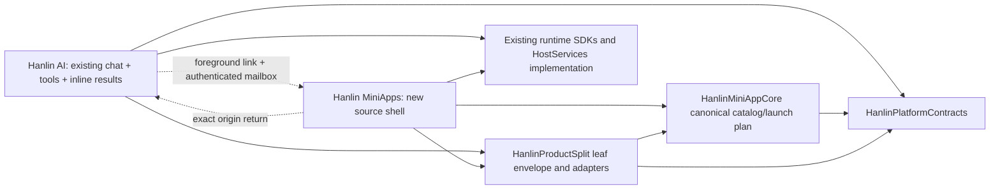

# Product split W1-003: source tranche and integration contract

> Historical W1-003 source record. Statements below about unconfigured services and pending integration describe that frozen tranche. For the current two-product implementation and actual outstanding native gates, use [CURRENT_BUILD_AND_RUN.md](CURRENT_BUILD_AND_RUN.md) and the [current release checklist](../continuation-20261117/RELEASE_CHECKLIST.md).

Acting owner: [איתן | ARCH+DEV] [MAIN_SESSION], primary `01a1dc79-6761-7463-a196-34771f7929bd`.
Worktree: `C:/Users/DAVID/Code/hanlin-app-split-wave1-20261115`; branch `codex/hanlin-app-split-wave1-20261115`.
Frozen starting revision: `dd700c03e9fe9d22e95a031d4684275512ee6e6f`.
Tasks: A `1219605220234118`, J `1219656771149125`, K `1219656771637321`, L `1219656771460030`; parent `1219605220179926`.

## Delivered boundary

This tranche adds leaf Swift adapters, a foreground lifecycle/codec, snapshot migration planning and fixture execution, a native MiniApps library shell, and a complete historical-ID inventory. Existing app/runtime/UI/permission source, manifests, locks, project files, entitlements and production data are untouched. No two-app installation, signed migration or cross-app execution is claimed. The app entry point intentionally uses `.unconfigured` services and reports an integration error instead of showing fabricated apps or success.

Source inspection identifies Hanlin as an independently maintained derivative of CherryHQ/Hanlin. The repository's later authoritative master specification prioritizes clean Hanlin boundaries over maintaining upstream patch compatibility. Here all changes remain downstream additions; no upstream-owned file was edited. Integration risk remains in target membership, existing app-only singleton dependencies, and storage/authority composition.

## Product ownership and dependency graph

| Area | Hanlin AI | Hanlin MiniApps | Shared implementation / persistent authority |
| --- | --- | --- | --- |
| Conversation, provider/agent loop, models, Skills, MCP, knowledge, memory, Canvas | Owns existing screens/stores and execution | Uses only explicit existing host/assistant APIs where supported | Existing canonical tool/result contracts; no second agent loop |
| Rich result presentation | Keeps native A2UI and legacy embedded results, inline evidence and actions | Full-screen app UI only | Existing typed results and engine result adapters; no transcript-schema change |
| Catalog and package lifecycle | Contextual discovery and validated open/return action | Owns catalog, import/preview/install/upgrade/rollback/uninstall, hidden/enabled and per-package details | Existing `HanlinCanonicalMiniAppCatalog`, `HanlinAtomicScriptStore`, registration and generation IDs |
| Execution | Retains agent-callable Swift/JS/TS/Node/Python/Shell and current tools | Hosts Swift, ScriptUI, NativeScript and Expo app UI | Reuse current runtime/SDK/HostServices source and packages; no copied tree or parallel permission engine |
| Cross-app handoff | Owns origin chat/session and result consumption | Owns active destination package session | Versioned split envelope around canonical identities; authenticated mailbox + foreground OS link, pending integration |

Shared means one implementation and canonical persistent identity/registry. Each process has its own legitimate in-process service instances and local runtime sessions; neither process is a permanent remote daemon. A tool that can execute locally in AI must continue to do so. Work requiring MiniApps UI requires an explicit foreground continuation. Do not route every tool to the companion or assume its process remains running.

## Real APIs and additive adapter

Verified from the baseline declarations, not invented ABI:

- `HanlinMiniAppDiscovery.registrations() async throws -> [any HanlinMiniAppRegistration]` and `HanlinCanonicalMiniAppCatalog(discovery:).items()` supply canonical catalog items.
- `HanlinMiniAppLaunchPlan(descriptor:entryPointKind:)` resolves the actual engine and rejects unavailable/invalid entry points.
- `HanlinMiniAppRequest(id:caller:target:action:capability:payload:)`, `HanlinMiniAppRequestBroker.request(_:) async throws -> HanlinMiniAppResponse`, and `HanlinMiniAppResponse.requestID` remain the canonical command/result types. `CanonicalRequestAdapter.swift` preserves these fields exactly; it does not turn callers into `hanlin.host`.
- Current app-only `HanlinMiniAppHost.refresh(installedPackages:)`, `swiftDestination(for:)`, `launchNativeScript`, `launchExpo`, `launchScriptingJSC`, and `ScriptingPackageCenterViews` must be reused through a composition/extraction decision. These are not exported package APIs. The new shell never claims it can import the current application module as a library.
- Existing `HanlinHostCallContext` holds subject/app/package/session/runtime/workspace identity. `HanlinHostServicesBroker.requireCapability(_:context:)` and `HanlinHostCapabilityAuthority.authorize(capability:context:)` are the current service authority paths. Their public behavior is unchanged.

The new `MiniAppsServices` is a UI composition seam in the new target source only. Its initializer accepts an existing discovery provider and launch/package-management closures; no ABI of existing source changes. `launchPlan(...)` validates live package/generation, target, declared action/capability and canonical entry-point/engine selection. A route without a declared action remains visibly unsupported; integration must decide the exact existing foreground action, never synthesize an always-allowed route.

## Bridge contract v1

`SplitBridgeRequest` carries immutable version, request UUID, canonical caller/target/installed-package/session IDs, origin chat UUID, generation, app entry-point kind, action/capability, issue/expiry times and `HanlinValue`. The serialized request/response budget is 64 KiB, lifetime at most 300 seconds, ledger at most 1024 retained requests. A return echoes the entire request; acceptance compares every field, authenticated sender, current generation, expiry and current authority decision. It returns the stored exact origin; never the currently visible chat. Duplicate returns are consumed once and reported as duplicate; callers may inspect a persisted terminal record to answer a retry without executing again. No tombstone eviction is implemented; capacity fails visibly until a separately designed archive policy exists.

State transitions: pending → dispatched → finished. A return before dispatch, second dispatch, stale generation, wrong package/session/chat/action/payload/sender, missing record, revoked/denied authority, or expired return fails without advancing state. Missing companion, offline, unavailable transport, cancellation and timeout are explicit failures. A recoverable dispatch failure stays pending so the caller can retry or call `finish` once; it must not display success. Device/network availability comes from the integration adapter, never from a URL. The local `online` flag can be true for a wholly local authenticated mailbox; internet is not a blanket execution requirement.

Wake URLs contain only an opaque non-secret request UUID and a fixed path. HTTPS host allowlisting, exact path/direction, bounded length, and rejection of credentials, ports, query strings, fragments and encoded path variations are implemented. The only host used in tests is `fixture.invalid`; no production domain or associated-domain registration is claimed. The URL is **not** an authorization token and contains no chat text, credentials or transport secrets.

Required transport composition, currently **unimplemented/BLOCKED_INTEGRATION**:

1. Persist the immutable envelope and ledger with integrity, existing data protection, expiry and bounded storage before opening the companion. Both identities and package/generation must come from trusted current host state. Never trust link-supplied origin/caller.
2. Resolve the UUID through an authenticated, entitlement-approved transport. A registered universal link identifies a destination app, not the app that initiated it. AppGroup eligibility does not by itself prove the caller of an individual request. Decide and verify mailbox origin/integrity protection using existing identity/Keychain facilities; no secret in the URL.
3. Reevaluate the current existing host policy, package installed/enabled state, generation, declared action and actual system authorization at execution and return. The `authorized` inputs are decisions supplied by that existing authority, not stored grants or a new policy engine.
4. Validate and explicitly persist receiver consumption/idempotency before invoking the canonical request broker. Sender ledger alone cannot prevent re-execution in a different process. Receiver implementation and crash-safe mailbox transactions are still required.
5. OS foreground open/return and cold-launch scene delivery must be wired at one integration window. On missing app/failed open show a useful unavailable state and retain AI's draft/chat; never claim background dispatch. Return through the authenticated mailbox and fixed AI link, then navigate by the saved chat/session identity.

Apple's readable Markdown documentation says universal links require the app/site association and warns to validate malformed parameters and avoid sensitive direct URL actions. This is the basis for treating URLs as hints only: [Supporting universal links](https://developer.apple.com/documentation/xcode/supporting-universal-links-in-your-app.md). HTML shells were not treated as read documentation; their linked Markdown versions were retrieved.

### Existing personal-host policy decision

At the frozen baseline, `HanlinHostCallContext` unions capabilities with `all` and `HanlinHostCapabilityAuthority.authorize` returns `.allowed` by design. The split parent records the owner's existing no-new-Hanlin-permission/sandbox policy. These findings are not a request to add a replacement grant regime or restrict ordinary local tools. They mean the integration must distinguish trusted cross-process origin/package lifecycle from in-process personal-host policy and retain actual iOS system authorization. The new disconnected code has no transport implementation and cannot convert an unauthenticated URL into a trusted host call. This decision is required only for connection; portable/source work proceeds independently.

## Data ownership and reversible migration

| Data | Owner / safe transition | Required integration acceptance |
| --- | --- | --- |
| ChatRecords/messages, drafts, attachments, reasoning, activity, results/evidence, Canvas versions, knowledge/chunks/memory/prompts | AI retains current store and UUID relationships in place | Snapshot consistent SwiftData + sidecars/assets; verify relationship and byte counts; no schema rebuild from feature JSON |
| Installed package archives/metadata, install IDs, app IDs, package versions/generations, hidden/enabled state, runtime app data | MiniApps/UI owns management, using one canonical installed registry | Source-to-target manifest and generation consistency; staged copy + readback; preserve original; coordinate concurrent writers |
| Shared scoped files/SQLite/bookmarks | Preserve app/package/agent/system ownership and relative paths | Original sandbox bookmarks may not be usable in companion; reauthorize where required, never replace with raw absolute paths |
| Skills/MCP/model configuration and credentials | AI retains current sources; MiniApps receives only explicit supported capabilities | Keychain access-group review, no secrets in snapshots/logs/URL; no silent access-group or bundle-ID change |
| Per-app grants and device/system permissions | Preserve policy metadata, use current authority; system decisions remain OS-owned | Do not infer permissions from copied metadata or transfer a device entitlement by copying JSON |
| CloudKit/SwiftData | Existing AI container `iCloud.com.itorah.chavrusachat` unchanged | Decide if any independent MiniApps data needs sharing; do not point two unrelated schemas at a live store or change CloudKit identity |
| Extensions/widgets/intents/Share/Translation | AI owns chat/share-to-chat; app-specific miniapp surfaces require explicit ownership | Each existing target's product linkage, data access, AppGroup, bundle identifier and installed-app-absent behavior reviewed individually |

Current entitlements list `group.com.itorah.chavrusachat` and `group.com.itorah.shared`; this is source configuration, not verified provisioning. Existing AI bundle ID is `com.itorah.chavrusachat`. Preserve it so AI remains an update of the existing app; choose/register a **new** MiniApps identity only under the integration/signing gate. A proposed `com.itorah.hanlinminiapps` identifier is a naming suggestion, not an assigned App ID.

AppGroup sharing and Keychain sharing require the relevant signed capabilities. Default private Keychain items do not become shared just by adding a second target. These semantics were read in [Apple Keychain sharing](https://developer.apple.com/documentation/security/sharing-access-to-keychain-items-among-a-collection-of-apps.md) and [App Groups entitlement](https://developer.apple.com/documentation/bundleresources/entitlements/com.apple.security.application-groups.md); no provisioning/SDK acceptance was executed.

Implemented fixture algorithm: versioned migration ID + exact source/destination snapshot → preflight path/identity/version/conflict checks → pure dry-run expected output → copy journal retaining full backup → interrupted partial snapshot persisted by fixture adapter → resume with exact current-state comparison → readback → explicit rollback only if output still equals the journal. Source is never changed. Same plan is deterministic; applying a complete journal is idempotent; modified output blocks rollback rather than overwriting user changes. Decoded plans/journals are revalidated. Fixed fixture slots and a synthetic marker restrict the disk test adapter; there is no path-taking production mutator.

Limits: snapshots are synthetic byte dictionaries, not live database backups. There is no production schema transform, encrypted snapshot format, fsync/crash-consistent multi-file commit, concurrent process lock, bookmark transfer, CloudKit migration or secure Keychain copier. Journal/destination writes in the fixture adapter are separately atomic, not one atomic transaction. A process crash between them is a detected conflict requiring recovery, not a proven automatic resume. These gaps prevent K/H/I completion and live migration; they do not justify an unsafe approximation.

## One controlled integration proposal

All steps below are a proposal for a designated exclusive integration lease, not edits performed here.

1. Register one new `HanlinProductSplit` leaf library depending on local `HanlinPlatform` products `HanlinPlatformContracts` and `HanlinMiniAppCore`; source path `Sources/HanlinProductSplit`. Keep `SplitFixtureStore` out of production target membership (test-support target or explicit source exclusion). Register focused XCTest/Swift Testing wrappers for the portable obligations, rather than treating the custom executable's `@main` as an XCTest source. No Package.swift is created in this tranche.
2. Add a distinct iOS app target with `HanlinMiniAppsApp` source membership only; exclude its `@main` from AI and exclude fixture support/tests from production. Preserve AI's existing target identity and iOS 27.0/Swift 6 source settings. CI currently selects xcode-27; do not infer installed SDK acceptance from settings. A designated build must verify exact stable SDK/availability.
3. Resolve the app-only `HanlinMiniAppHost` and `HanlinScriptingPlatform` dependency closures once. Prefer a narrowly extracted shared composition/provider around the **existing** implementation over copying those files or adding the entire AI app to the new target. Current access levels/singletons and package-management SwiftData dependencies make this a real integration task. Obtain Noam's contract acknowledgement for any required exported API change; no new API is presumed here.
4. Supply the shell's `MiniAppsServices(discovery:launch:packageManagement:)` from that real provider. Use existing package preview/lifecycle screens and Swift/ScriptUI/NativeScript/Expo launch surfaces; preserve grant/lifecycle/settings behavior. Add create/update/hidden and category UI from existing semantics after J acceptance. The present shell implements catalog browsing/search/detail/open/presentation and management routing; unconfigured providers fail explicitly.
5. Implement authenticated mailbox + durable sender/receiver consumption and actual foreground URL lifecycle after transport/identity policy review. Register distinct open and return paths in verified site association. Handle the AI compact tools/MiniApps action through Maya's existing action bridge at the integration seam; Split never edits ChatInput or Maya's exclusive ChatViewBottom path.
6. Keep AI's A2UI and legacy result consumers intact; package tool discovery remains AI-accessible. Integrate A2UI official renderer pin/envelope separately with its owner. No result/transcript migration occurs in this tranche.
7. Decide store ownership and verified entitlement availability, then build a versioned live snapshot/copy/recovery tool from the fixture algorithm with the missing atomicity/locking/security guarantees. Run dry-run against consented copies before any live migration. No source move/delete is necessary for the initial two-app assembly.

## Acceptance gates

- `coverage-results.json` proves all 278 historical IDs and required fields/digests, not feature behavior. Current per-row statuses remain NOT_RUN/BLOCKED. Anchors marked COMPONENT_ANCHOR_ONLY identify a responsible current component; they do not verify that specific feature's implementation.
- `legacy-ui-decisions.json` maps all 26 canonical summary choices from the parent task. The full historical master-prompt attachment was not found in this worktree; that limitation is retained, not replaced by invented detailed decisions. J visual/IA approval stays open.
- `portable-results.json` records actual Windows Swift execution for owned codec/state/migration/adapters and fixed-root synthetic disk fixtures, with strict concurrency and warnings-as-errors. `validator-results.json` records adversarial validator tests.
- NOT_RUN: SwiftUI semantic compile, full package/app build, two targets installable independently, sender/receiver cross-process execution, receiver crash/replay recovery, cold launch, actual missing-companion open, iPhone/iPad/RTL/VoiceOver/Dynamic Type UI, extension/Keychain/AppGroup/CloudKit migration, signed physical device and owner visual acceptance. Remote slot remains Runtime-owned. H `1219605235147314` and I `1219605282038820` stay open.

Reproduce coverage with `py -3 Scripts/ProductSplit/parity_inventory.py`; adversarial validation with `py -3 -m unittest discover -s Tests/ProductSplit -p test_parity_inventory.py -v`; actual portable Swift with `py -3 Scripts/ProductSplit/run_portable.py`. The latter compiles unchanged real contract sources except the unused SwiftPM resource helper `HanlinManifestSchema.swift`; it compiles the actual canonical catalog and request broker subset, not the full HanlinPlatform product. No fake Bundle.module, replacement authority, dependency installation, CI or remote SDK run is used.
