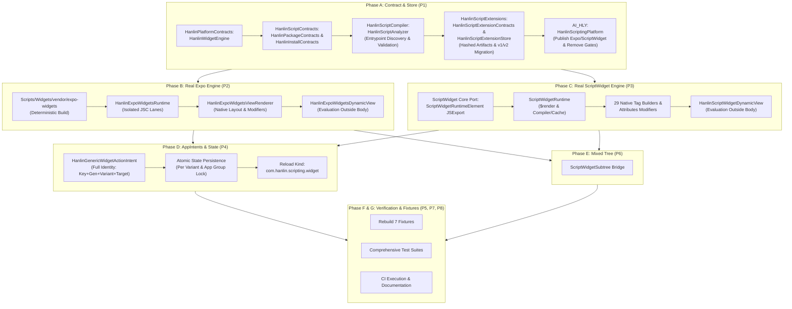

> Pass 3 audit, 2026-10-30: the following Pass-2 claims are historical and unverified for the dirty starting tree at ce586667b7103a6c2c7243d33461768c51a9dd8d. They are not current acceptance results. Current execution evidence is in CI_AND_DEVICE_RESULTS.md and TEST_MATRIX.md.

# PASS2 SOURCE AUDIT — DUAL NATIVE WIDGET ENGINES

**Document Prepared:** 2026-10-30
**Repository:** `https://github.com/davidpovarsky/hanlin-ai`
**Active Working Branch:** `integration/hanlin-dual-widget-engines-20261029`
**Verified Branch HEAD:** `ce586667b7103a6c2c7243d33461768c51a9dd8d`
**Merge Base with `origin/integration/expo-nativescript-search-20261029`:** `333352ac251767b8b42e6ccdf37dbcdc7ae49149` (47 commits ahead, 0 behind)
**Last Code-Validated CI Run:** `40994342575` on commit `e92265179d044d30f04827863e849674767ef136` (SUCCESS for 11 foreground Expo UI methods and 12 extension suite tests)
**Scope Guard:** Chat UI files (`AI_HLY/ChatView.swift`, `AI_HLY/Views/Components/ChatViewBottom.swift`, `AI_HLY/Views/Components/ChatViewComponents.swift`, `AI_HLY/Views/Components/ChatandFile.swift`) remain untouched. Asana is strictly READ-ONLY.

---

## 1. Pinned Upstream Provenance & Revisions

1. **Expo Widgets Upstream Pin:**
   - Repository: `https://github.com/expo/expo`
   - Git Head SHA: `917a61b581baeb852aa4fe331da2c1395d824351` (`expo-widgets@58.0.3`)
   - Sources: `ios/Widgets/{ViewRenderer,DynamicView,ChildView,Fragment,Buttons,AppIntent,WidgetsJSRuntime,WidgetsLayoutRegistry,EntryView,TimelineProvider,TimelineEntry,Type,Utils,RedBoxView}.swift`, `ios/{WidgetsContext,WidgetsStorage}.swift`, `bundle/{index,decorator,ui-globals,jsx-runtime-stub}.ts`, `scripts/build-bundle.mjs`.
   - License: MIT License (Expo / 650 Industries, Inc.)

2. **ScriptWidget Upstream Pin:**
   - Repository: `https://github.com/everettjf/scriptwidget`
   - Git Head SHA: `68f04194f00222558c44d5a832e7617a96f62574`
   - Sources: `Shared/ScriptWidgetRuntime/Widget/Runtime/ScriptWidgetRuntime.swift`, `Component/{ScriptWidgetRuntimeElement,ScriptWidgetElementView}.swift`, `Component/Elements/ScriptWidgetElementTag*.swift` (all 29 native element tags), `Component/Attributes/*`, `Util/{MineGaugeView,MineRingView,ScriptWidgetElementColor,ScriptWidgetElementGradient,ScriptWidgetElementPoint}.swift`, `Resource/support.bundle/{core.js,moment.min.js,util.js}`.
   - License: Apache License, Version 2.0 (Copyright 2020 everettjf).

3. **Native Binary ABI Closure:**
   - Platform Target: iOS / iPadOS 27.0
   - Architecture: `ios-arm64` (device), `ios-arm64_x86_64-simulator` (macOS CI & local test runner).
   - Precompiled XCFrameworks in `Packages/HanlinExpoRuntime/Artifacts/`:
     - `ExpoUI.xcframework`: `public` types `ExpoSwiftUI.AnyChild`, `ExpoSwiftUI.StringIdentityChild`, `UIBaseView`, `TextView`, `HStackView`, `VStackView`, `ZStackView`, `OverlayView`, `BackgroundView`, `MaskView`, `SlotView`, `RectangleView`, `RoundedRectangleView`, `CapsuleView`, `CircleView`, `ImageView`, `DividerView`, `EllipseView`, `LabelView`, `ProgressView`, `SpacerView`, `UnevenRoundedRectangleView`, `GaugeView`, `ChartView`, `Button`, `LinkView`.
     - `ExpoModulesCore.xcframework`: `public` types `AppContext`, `ViewProps`, `UIBaseViewProps`, `ButtonProps`.
     - Static Mach-O link closure with `APPLICATION_EXTENSION_API_ONLY = YES` in `HanlinScriptingWidgets.appex`.
     - Portable Swift fallback / pure Swift native implementation in `HanlinScriptExtensions` for host `swift test` (macOS), with `#if canImport(ExpoUI)` full parity on iOS.

---

## 2. Source-Verified Defect Audit (P2-01 through P2-24)

| ID | Verified Code Evidence at `ce586667` | Exact Root Cause & Impact | Required Fix |
|---|---|---|---|
| **P2-01** | `HanlinScriptingPlatform.swift:824` accepts `root: HanlinScriptUINode`. `refreshExtensionSnapshot()` lines 1010-1060 appends `.legacy` snapshots without `engine: .expo` or `.payload(.expo)`. | Newly installed Expo and ScriptWidget packages are published only as `.legacy` snapshots, failing to reach their native engines. | Implement typed `publishExpoWidget` / `publishScriptWidget` writing `engine: .expo` and `engine: .scriptwidget` with hashed App Group artifacts. |
| **P2-02** | `HanlinScriptAnalyzer.swift:647-650` treats `manifest.entry` as `.app`. Lines 386-394 require `appEntrypoints.count == 1`. | Rejects widget-only `.hanlinExpo` or ScriptWidget packages for lacking a foreground `.app`. Only discovers `.tsx`/`.ts`/`.json`. | Support explicit `widgetEngine` in manifest/entrypoint contract. Recognize widget-only archives (`widget.js`, `widget.jsx`, `main.jsx`) and validate widget ABI without requiring an `.app`. |
| **P2-03** | `Scripts/Widgets/build-sample-packages.mjs` generates packages with `entry` misclassified as `.app`. Generated packages omit `package.json.hanlinRuntime`. | Sample packages fail analyzer preflight or fall back to `.legacy`. | Rebuild all seven installable sample archives from source with correct manifests, explicit `widgetEngine`, and verified hashes. |
| **P2-04** | `HanlinGenericWidgetActionIntent.swift:45,55` hardcodes `generation: 1` and reloads `"HanlinScriptingWidget"`. Uses `try?` on store operations. | Wrong kind reload (`com.hanlin.scripting.widget` is registered). Stale generation 1 fails on generation N. Errors swallowed. | Unify AppIntent router to carry full identity (`installedPackageID`, `generation`, `entrypointID`, `engine`, `variantID`, `target`, `nonce`), reload exact kind, report errors. |
| **P2-05** | `HanlinGenericWidgetActionIntent.perform()` does not invoke `handlePress` or persist returned props. `handlePress` expects `environment.target`. | Expo `onPress` buttons do not execute or mutate state when app is closed. | Execute `__expoWidgetHandlePress` with `environment.target` on serialized lane, persist updated props atomically, test `7 -> 8 -> 7`. |
| **P2-06** | `HanlinScriptWidgetElements.swift:81,105` creates AppIntents with `packageID: ""`, `entrypointID: ""`. `renderToggle` has constant `isOn`. | ScriptWidget buttons/toggles cannot identify package or persist state. | Connect declared ScriptWidget actions and state keys to scoped AppIntents and atomic `$storage` mutations. |
| **P2-07** | `HanlinScriptWidgetRuntime.swift:54-84` uses synthetic IIFE `render(elem)` returning dictionary. `HanlinScriptWidgetElementView.swift` is a basic 13-case switch. | Incompatible with upstream ScriptWidget JSX, custom functional components, JSExport element protocol, and `$render`. | Port genuine `everettjf/scriptwidget` (`68f04194`) runtime (`ScriptWidgetRuntime`, `ScriptWidgetRuntimeElement` JSExport, `$render`, all 29 tag builders). |
| **P2-08** | `HanlinExpoWidgetsViewRenderer.swift:123` maps `OverlayView`, `BackgroundView`, `MaskView`, `SlotView` to a plain `VStack(spacing: 0)`. | Corrupts visual layout and layer composition of native Expo widgets. | Port authentic layout semantics (primary child + overlay/background/mask, SlotView projection, Text concatenation). |
| **P2-09** | `HanlinExpoWidgetsDynamicView.swift:26` calls `.render(...)` in `body`. `HanlinScriptWidgetDynamicView.swift:20` calls `.execute(...)` in `body`. | Runs JavaScriptCore synchronously during SwiftUI view tree layout, causing stalls and potential thread safety hazards. | Evaluate layout outside SwiftUI `body` during timeline entry / model preparation. Keep `body` pure presentation. |
| **P2-10** | `HanlinExpoWidgetsRuntime.swift:14` and `HanlinScriptWidgetRuntime.swift:14` hold single global `JSContext` with `@unchecked Sendable` and NSRecursiveLock. | No per-package isolation; cross-widget global leakage; actor concurrency hazards. | Provide per-package/generation/variant context isolation and serialized queue execution lanes. |
| **P2-11** | `HanlinScriptExtensionContracts.swift:36,53` embeds full layout and script strings directly in `snapshot-v1.json` 4 MiB envelope. | Bloats snapshot file; risks exceeding memory budget; lacks immutable hashed resource bundles. | Store immutable compiled artifacts by content hash in App Group (`generations/<N>/artifacts/<hash>`), referencing them from compact snapshot. |
| **P2-12** | `HanlinScriptPackageEntityQuery.swift:54` IDs use `packageID|entrypointID`. `selectedSnapshot` defaults to first snapshot when unconfigured. | Unconfigured widget shows wrong content. Two placements of same package share state. | Add stable variant/instance selection (`A1`/`A2`); show "Choose a Script" placeholder when unconfigured. |
| **P2-13** | Root `.widgetURL(entry.snapshot?.deepLink)` in `HanlinScriptingWidget` wraps the entire widget view. | Intercepts taps intended for interactive child `Button` and `Link` views. | Scope `.widgetURL` to non-interactive regions; ensure interactive children take hit-test precedence. |
| **P2-14** | `HanlinWidgetPayload.init(from:)` default case coerces unknown or corrupt kinds to `.legacy`. `HanlinExtensionSnapshotView` falls back to `snapshot.root`. | Silently masks engine failures and displays incorrect fallback content. | Explicit error states for malformed/corrupt engine payloads; retain legacy fallback only for genuine legacy envelopes. |
| **P2-15** | `Scripts/Widgets/build-expo-bundle.mjs` hardcodes personal scratch path `C:/Users/DAVID/...` in comments. | Non-reproducible builds; breaks on other machines or clean CI environments. | Strip local paths (`--legal-comments=none`); vendor sources into repo; verify deterministic build hash. |
| **P2-16** | `docs/widget-engines/UPSTREAM_PROVENANCE.md` incorrectly identified ScriptWidget license as MIT. | Inaccurate license attribution. | Correct upstream license attribution to Apache License, Version 2.0 with proper notices. |
| **P2-17** | `docs/widget-engines/RELEASE_AND_ROLLBACK.md` proposed git checkout without backward-compatible schema handling. | Older host loading schema 2 snapshot throws `unsupportedSchema(2)`. | Dual-write `snapshot-v1.json` (schema 1 compatible) and `snapshot-v2.json`; test actual downgrade recovery. |
| **P2-18** | `HanlinDualWidgetEnginesTests.swift` had 5 tests that asserted only `type(of: view) == AnyView`. | Weak assertions did not verify JSC execution, tag rendering semantics, or AppIntents. | Add comprehensive XCTest suites testing real JSC execution, all 29 native tags, and AppIntent state persistence. |
| **P2-19** | Prior reports conflated 12 extension suite tests with 12 dual-engine tests. | Inaccurate accounting masked testing gaps. | Accurately record individual test identities and execution statuses. |
| **P2-20** | `COMPONENT_PARITY_MATRIX.md` claimed `FULL_PARITY` for incomplete implementations. | Overstated parity for Chart, GIF, Button/Toggle, and Chip. | Audit all 29 tags and modifiers with truthful statuses (`NATIVE_PASS`, `PARTIAL`, `UNSUPPORTED_BY_WIDGETKIT`). |
| **P2-21** | B03 IPv4 DNS reordering was claimed as full root cause without embedded HTTPS/fd leak tests. | Speculative fix without embedded runtime verification. | Retain known-good NativeScript path; add embedded Node HTTPS/fd regression tests. |
| **P2-22** | B04 `matchContents={true}` in RNHostView is a bounded layout workaround, not an ABI fix. | Potential Fabric dynamic sizing crash if unbounded. | Retain safe workaround; label accurately as `MITIGATED / ROOT_CAUSE_UNVERIFIED`. |
| **P2-23** | `refreshExtensionSnapshot()` line 941 still filtered on `required.isSubset(of: granted)`. | Hanlin approval gates blocked ordinary widget refresh. | Remove Hanlin approval gating from normal widget discovery/extension publication per owner policy. |
| **P2-24** | `TEST_MATRIX.md` marked all B01–B09 CLOSED without individual gate evidence. | Lacked verifiable execution proofs for gates G01–G24. | Establish rigorous G01–G24 ledger citing exact SHAs, test cases, and artifact digests. |

---

## 3. Dependency Impact & Execution Map

This audit completes Milestone P0. We now immediately proceed to Phase A (P1) implementation.

## Pass 3 corrective appendix — 2026-10-30

The dirty ce586667 starting work was preserved before edits. The supplied Pass-3 mandate identifies 31 corrective findings. The handwritten Expo/ScriptWidget native replicas, string-toggle/hardcoded-counter intent, body-time JSC fallbacks, suffix engine inference and unchecked dual-write store were not authentic acceptance evidence. Source ports, prepared programs, verified loading, configured instances, source actions and transactional revisions now replace those paths, but Apple compilation, native component/OS tap tests and device acceptance remain pending. The previous 12 method names were not 12 executed Apple tests. Historical 40994342575 remains prior foreground evidence only. See TEST_MATRIX.md and CI_AND_DEVICE_RESULTS.md for current statuses.

### Executed follow-up — 2026-10-31

The 31 findings now map individually to assertions/status in TEST_MATRIX.md. Real Apple package run 41239674500 at 5bfcf03b passed the focused extension/analyzer suites; source-only ExpoUI subset AND renderer bridge compile/link passed in 41239669157. App/appex build passed in 41239679485, with final iOS native/UI outcomes pending. These measured results supersede the preceding pending sentence only for their explicit scope. Full changed-path inventory, including retained Pass-2 paths, is PASS3_CHANGED_PATH_AUDIT.json; no measured failing-before run is invented for the initial dirty state.
